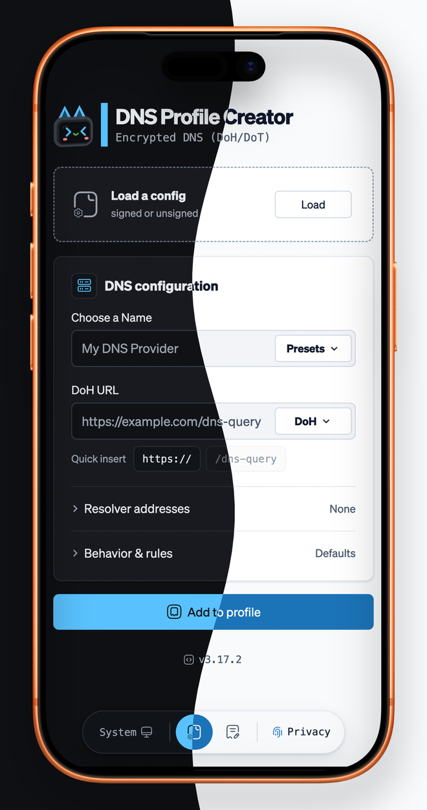

# Apple DNS Profile Creator

[](https://github.com/tofulupo/apple-dns-profile-creator/actions/workflows/check.yml)
[](test/invariants/)
[](https://github.com/tofulupo/apple-dns-profile-creator/commits/main)

[](https://github.com/tofulupo/apple-dns-profile-creator/releases)
[](#desktop-app)

[](https://liberapay.com/tofulupo/donate)

Builds encrypted DNS (DoH and DoT) profiles for iPhone, iPad and Mac, and opens,
compares and signs the ones you already have. It is a website, with its own
layout for phones and one for the desktop, and a dedicated macOS app. Nothing is
uploaded, and there are no accounts.

**[Try it out](https://mobileconfig.io)**: no install, no sign-up, nothing
leaves your device ([privacy](#privacy)).

[](https://helium.computer/)
[](https://librewolf.net/)
[](https://orionbrowser.com/)

Tested with these three, which are also my recommendation if privacy matters to
you: Helium is Chromium without Google, LibreWolf is Firefox without telemetry,
and Orion is WebKit, like Safari, without telemetry.

Apple has supported DNS over HTTPS and DNS over TLS since iOS 14 and macOS 11,
but has no screen for it. A configuration profile turns it on without an extra
app, and this tool builds those profiles.


## What it does

<!-- rumdl-disable MD033 -->

<!-- rumdl-enable MD033 -->

- Start from one of six presets, or enter any DoH URL or DoT host with up to two
  IPv4 and two IPv6 addresses. Your own resolver works too. The presets show the
  country a provider runs in and what it says about logs, DNSSEC and blocking.
- Turn encrypted DNS off for named Wi-Fi networks or domains, or use it only for
  named domains
  ([details](https://github.com/tofulupo/apple-dns-profile-creator/wiki/Domain-rules)).
- Pick Wi-Fi, cellular and Ethernet one by one. With Failover on, the device
  falls back to the network's own DNS when the encrypted server doesn't answer
  (OS 26 and later).
- Put several configurations in one profile. The device uses one at a time
  ([details](https://github.com/tofulupo/apple-dns-profile-creator/wiki/Several-configurations)).
- Open a profile you already have, signed or not, and see what is in it. Pick
  another resolver for it and keep its rules
  ([moving from Mullvad](https://github.com/tofulupo/apple-dns-profile-creator/wiki/Moving-from-Mullvad)).
  Compare two cards side by side.
- Desktop app only: sign with a certificate from your Keychain, and send a
  profile to an iPhone with AirDrop from the Share button.


## Who it's for

**Setting it up for yourself or for someone else.** Pick a preset, leave the
rest alone, download. The app has no account and doesn't need an internet
connection. Installing is the part that takes a few taps on the device, see
[Installing and removing](https://github.com/tofulupo/apple-dns-profile-creator/wiki/Installing-and-removing).

**A household with its own resolver.** Enter your DoH URL or DoT host and add
your home network under Wi-Fi exceptions. Devices then use the network's DNS at
home and encrypted DNS everywhere else. Leave the exceptions empty to use
encrypted DNS everywhere. Save one profile per phone and AirDrop each one.

**Looking after a few Macs.** Drop in a colleague's profile to read its settings
without installing it. A signed profile that was changed after signing gets a
warning before it loads. Output is the same every time for the same input, and
CI checks every generated profile against golden files and, on macOS, against
Apple's `plutil -lint`.

**Working with a serious threat model.** The app makes no network requests,
opens no port, and has no telemetry, crash reporting or update check. Tests in
[`test/invariants/`](test/invariants/) fail if that changes. The signing key
stays in the Keychain. Cards are forgotten when you quit unless you turn that
off in Settings. Every feature works from a source checkout, so you can
[build the app yourself](#build-it-yourself).

## What a profile can't do

- It changes where DNS lookups go and how they travel. It doesn't hide your IP
  address, protect a device that is already compromised, or stop someone from
  watching which servers you connect to.
- Some apps and tools don't use the system's DNS settings. Reported examples are
  VPN clients, iCloud Private Relay, the App Store and command line tools like
  `dig`. Captive portals on hotel and airport Wi-Fi are exempt too. See the
  [known issues](https://github.com/paulmillr/encrypted-dns#known-issues) of
  paulmillr's profiles.
- The app blocks nothing. If a resolver filters ads or malware, that is the
  resolver's doing.
- DoT is easier to detect and block than DoH.
- A signature shows whether a file changed after it was signed. It doesn't show
  who made it. Devices label a signed profile "Verified" only if they trust the
  certificate's issuer, and a self-signed certificate shows "Not Verified".
- Lock profile only does something on supervised devices.
- A device in Lockdown Mode won't install a profile. Per
  [Apple](https://support.apple.com/en-us/105120), turn Lockdown Mode off,
  install, and turn it on again.
- There is no command line tool, no MDM deployment and no Windows or Linux app.
  The website opens in any browser, but only Apple devices install the profiles.

## Get the app

The desktop app needs macOS 15.8 or newer and is about 6 MB. Build the app from
its tag, as described under [Build it yourself](#build-it-yourself).

### Desktop app

The app is built with [Tauri 2](https://tauri.app) and uses the system's own
webview. The pages load from inside the app; nothing listens on the network.

Only macOS is built for now: a `.mobileconfig` can only be installed on Apple
devices. Saving, Settings and where the app keeps its files:
[The desktop app](https://github.com/tofulupo/apple-dns-profile-creator/wiki/The-desktop-app).

## Privacy

[](https://www.ssllabs.com/ssltest/analyze.html?d=mobileconfig.io)
[](https://developer.mozilla.org/en-US/observatory/analyze?host=mobileconfig.io)
[](https://securityheaders.com/?q=mobileconfig.io&followRedirects=on)

The website at mobileconfig.io is a showcase. It builds the profile in your
browser and sends nothing back: no cookies, no analytics, no requests to other
sites. Your configurations stay in this tab and are deleted when you close it.
To keep them in the browser, open Privacy at the top of the page (in the bar at
the bottom on phones) and turn the switch off. The browser's cache and history
still show the visit. For zero traces, use a private window. The server only
hands out the site's files and keeps nothing.

It runs on its own server in Iceland. The server keeps no access log, answers
only GET and HEAD, and speaks TLS 1.3 only, with HTTP/3 and Encrypted Client
Hello. Like any server, it sees your IP address while it answers.
`deno task check:live` checks the headers, TLS, redirects and `security.txt`
from outside, so you don't have to take this on trust. If that matters to you,
run the tool yourself on your own machine or home network (see
[Build it yourself](#build-it-yourself)), or use the
[desktop app](#desktop-app), which needs no network to build, sign or save a
profile.

## Signing

Profiles from the website are **not** signed; the desktop app can sign them with
a Keychain certificate. An unsigned profile installs identically; iOS and macOS
just label it "Not Signed" during installation. Signing changes that label and
adds tamper protection, nothing else.

Signing with the Keychain and making a self-signed certificate:
[Signing profiles](https://github.com/tofulupo/apple-dns-profile-creator/wiki/Signing-profiles).

## Build it yourself

Needs [Deno](https://deno.com) 2.9 or newer. The app also needs
[Rust](https://rustup.rs) 1.85 or newer and Xcode 26 or newer.

```sh
git clone https://github.com/tofulupo/apple-dns-profile-creator.git
cd apple-dns-profile-creator
git checkout v4.0.0-rc.3
deno task build      # the website, as static files in dist/
deno task desktop    # the macOS app
```

`dist/` works on any web server, over HTTP or HTTPS, with nothing server-side.
`deno task preview` serves it on your network at port 5173, so a phone can open
it. The app ends up in `src-tauri/target/release/bundle/macos/`.

Your build differs from the official one in two ways: without the licensed Söhne
fonts it uses a fallback font with the same metrics, and the app is signed ad
hoc, which is enough to run it on the Mac that built it.

To see which commit mobileconfig.io runs, read its
[`build.txt`](https://mobileconfig.io/build.txt), or let
`deno task check:live --commit <sha>` compare it with yours.

## Documentation

- [How-tos in the wiki](https://github.com/tofulupo/apple-dns-profile-creator/wiki):
  installing, signing, domain rules, several configurations, file names, moving
  from Mullvad
- Working on the code: [docs/DEVELOPMENT.md](docs/DEVELOPMENT.md)
- Reporting a security problem: [SECURITY.md](SECURITY.md)

## History and thanks

This started as a fork of [fyr77/dns-mobileconfig][upstream] and has since been
substantially rewritten: the core was rebuilt as a tested TypeScript library,
cookies were replaced with `localStorage`, the external signing service was
removed.

- Paul Miller for [his article](https://paulmillr.com/posts/encrypted-dns/) and
  his [premade profiles](https://github.com/paulmillr/encrypted-dns), which the
  test suite uses as fixtures
- [Mullvad](https://github.com/mullvad/encrypted-dns-profiles) for their
  published profiles
- [Reicon](https://reicon.dev) for the server, shield, receipt, sun, moon,
  monitor, download, info and card-remove icons in `public/icons/` (MIT, see
  `public/icons/LICENSE-reicon.txt`)
- zest for the [git-repository icon][zest-icon] from Zest Interface Icons,
  redrawn as the source code icon on the version badge, in
  `public/icons/source-code.svg` (MIT, see `public/icons/LICENSE-zest.txt`)
- [flag-icons](https://github.com/lipis/flag-icons) for the country flags in the
  presets menu, in `flags/` (MIT, see `flags/LICENSE-flag-icons.txt`)

[upstream]: https://code.diluvian.cc/fyr77/dns-mobileconfig
[zest-icon]: https://www.svgrepo.com/svg/509965/git-repository

## Disclaimer

No warranty or liability is provided on the generated files. Use at your own
risk.
